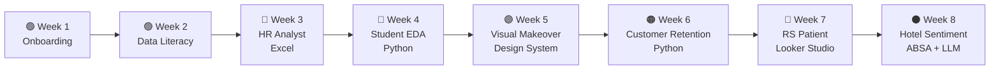
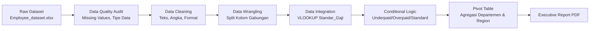
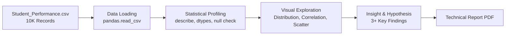
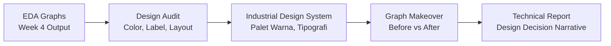
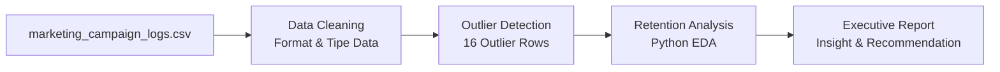
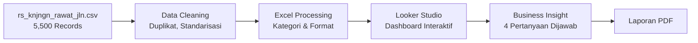
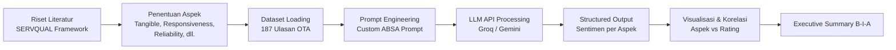

# 📊 Vinix Data Analyst Portfolio

### _End-to-End Data Analytics Journey: From Onboarding to AI-Powered Sentiment Analysis_


-red?style=for-the-badge>)


---

## 📌 Executive Summary

Program ini dirancang secara progresif — dimulai dari pengenalan fundamental data literacy, kemudian meningkat ke data cleaning & wrangling di Excel, exploratory data analysis (EDA) dengan Python, visualisasi data profesional, analisis retensi pelanggan, pembangunan dashboard interaktif, hingga puncaknya pada **Aspect-Based Sentiment Analysis (ABSA)** menggunakan Large Language Model (LLM) API.

```
Data Analyst
8 Modul  |  6 Project Deliverables  |  5 Tools  |  15 LogBooks
Excel → Python (Pandas, Matplotlib, Seaborn) → Looker Studio → LLM API (Groq)
```

---

## 🗺️ Program Roadmap & Weekly Progression



### Skills Progression Matrix

| Week |   Modul    | Domain             | Core Skill Acquired                               | Tool / Stack                             |
| :--: | :--------: | :----------------- | :------------------------------------------------ | :--------------------------------------- |
|  1   | Onboarding | —                  | Program orientation, team formation               | -                                        |
|  2   | Onboarding | —                  | Critical Thinking & Data Literacy                 | -                                        |
|  3   |  Modul 3   | Human Resources    | Data Cleaning, Wrangling, Pivot Table, VLOOKUP    | **Microsoft Excel**                      |
|  4   |  Modul 4   | Education (EdTech) | EDA, Statistical Profiling, Hypothesis Generation | **Python** (Pandas, Matplotlib, Seaborn) |
|  5   |  Modul 5   | Education (EdTech) | Visual Graph Makeover, Industrial Design System   | **Python** (Matplotlib)                  |
|  6   |  Modul 6   | Marketing & CRM    | Customer Retention Analysis, Outlier Detection    | **Python** (Pandas, Matplotlib)          |
|  7   |  Modul 7   | Healthcare         | Interactive Dashboard, BI Storytelling            | **Looker Studio**, Excel                 |
|  8   |  Modul 8   | Hospitality        | ABSA, Prompt Engineering, NLP with LLM API        | **Python**, Groq API, LLM                |

---

## 📅 Week 1 — Onboarding & Program Kick-Off


### 📋 Ringkasan Kegiatan

Minggu pertama difokuskan pada **orientasi program MSIB** dan pembentukan struktur organisasi tim magang.

## 📅 Week 2 — Data Literacy & Team Building


### 📋 Ringkasan Kegiatan

Minggu kedua berfokus pada **pembekalan soft skills** dan pengenalan konsep **Critical Thinking & Data Literacy** sebagai fondasi untuk modul-modul analitis selanjutnya.

## 📅 Week 3 — HR Performance Analyst _(Excel)_


### 📋 Konteks Bisnis

Klien korporat menunjuk Vinix7 untuk membangun **HR Performance Dashboard**. Dataset karyawan yang diserahkan terdiri dari 2 sheet: `Raw_Data` (profil & metrik karyawan) dan `Standar_Gaji` (tabel referensi kompensasi per departemen). Data mentah masih berisi berbagai anomali akibat proses input manual bertahun-tahun.

### 🛠️ End-to-End Workflow



### 📐 Dataset & Grain

- **Dataset:** `Employee_dataset.xlsx` — 2 sheets (Raw_Data + Standar_Gaji)
- **Grain:** 1 baris = 1 profil karyawan dengan metrik performa & kompensasi
- **Dimensi:** Departemen, Region, Gaji Aktual, Standar Kompensasi Min/Max

### 💻 Metodologi Analisis (Excel Functions)

```
=== Data Quality & Cleaning ===
• TRIM(), CLEAN(), PROPER()      → Pembersihan teks & standarisasi huruf kapital
• VALUE(), TEXT(), DATEVALUE()    → Konversi tipe data yang tercampur
• IFERROR(), ISBLANK()           → Deteksi missing values & error handling

=== Data Wrangling ===
• LEFT(), RIGHT(), MID(), FIND() → Pemisahan kolom gabungan (Departemen + Region)
• SUBSTITUTE()                   → Standarisasi format penulisan

=== Integration & Conditional Logic ===
• VLOOKUP() / INDEX-MATCH()      → Integrasi Raw_Data ↔ Standar_Gaji
• IF(AND(), IF())                → Nested logic evaluasi kompensasi:
  → "Underpaid" (gaji < batas minimum)
  → "Overpaid" (gaji > batas maksimum)
  → "Standard" (dalam rentang)

=== Aggregation ===
• Pivot Table                    → Persebaran status kompensasi per Departemen & Region
```

### 📈 Key Findings

```
┌──────────────────────────────────────────────────────────────────────┐
│ HR COMPENSATION ANALYSIS                                            │
├──────────────────────────────────────────────────────────────────────┤
│ • Teridentifikasi anomali data: missing values, tipe data tidak     │
│   valid (angka tercampur teks), inkonsistensi format tanggal &      │
│   huruf kapital, serta kolom gabungan Departemen-Region.            │
│ • Evaluasi kompensasi: ditemukan sebaran karyawan Underpaid &       │
│   Overpaid yang tidak merata antar departemen.                      │
│ • Pivot Table mengungkap pola ketimpangan kompensasi yang dapat     │
│   menjadi dasar keputusan HR untuk penyesuaian gaji.                │
└──────────────────────────────────────────────────────────────────────┘
```

### 📁 Struktur File

| File                                                | Deskripsi                                                |
| :-------------------------------------------------- | :------------------------------------------------------- |
| `Employee_dataset.xlsx`                             | Raw dataset karyawan dari klien                          |
| `HR_Performance_Analyst.xlsx`                       | Workbook analisis lengkap (Cleaning → Wrangling → Pivot) |
| `HR_Performance_Executive_Report.pdf`               | Laporan Eksekutif final untuk klien                      |
| `HR_Performance_Executive_Report_Editable.docx`     | Versi editable laporan                                   |
| `Tutorial_Excel_HR_Data_Analyst_Click_by_Click.pdf` | Dokumentasi tutorial step-by-step                        |

---

## 📅 Week 4 — Student Performance EDA _(Python)_


### 📋 Konteks Bisnis

Klien Vinix7 di bidang **EdTech** (Education Technology) sedang merancang program intervensi akademik untuk membantu siswa yang kesulitan belajar. Klien menyerahkan dataset berisi **10.000 catatan performa siswa**. Sebelum tim Machine Learning membangun model prediksi, Tim Data Analyst diminta melakukan **EDA (Exploratory Data Analysis)** komprehensif untuk menggali pola tersembunyi.

### 🛠️ End-to-End Workflow



### 📐 Dataset & Grain

- **Dataset:** `Student_Performance.csv` — **10,000 baris** catatan performa siswa
- **Grain:** 1 baris = 1 siswa dengan atribut belajar & performa
- **Target Variable:** `Performance Index` (skala 10–100)

### Column Dictionary

| Column                             | Data Type   | Business Meaning                                   |
| :--------------------------------- | :---------- | :------------------------------------------------- |
| `Hours Studied`                    | Numeric     | Jam belajar per minggu                             |
| `Previous Scores`                  | Numeric     | Skor ujian sebelumnya                              |
| `Extracurricular Activities`       | Categorical | Keterlibatan aktivitas ekstrakurikuler (Yes/No)    |
| `Sleep Hours`                      | Numeric     | Rata-rata jam tidur per hari                       |
| `Sample Question Papers Practiced` | Numeric     | Jumlah latihan soal yang dikerjakan                |
| `Performance Index`                | Numeric     | **Target metric** — Indeks performa siswa (10–100) |

### 💻 Analytical Deep-Dive (Python)

```python
# === Statistical Profiling ===
import pandas as pd
import matplotlib.pyplot as plt
import seaborn as sns

df = pd.read_csv('Student_Performance.csv')
print(df.describe())     # Statistik deskriptif
print(df.info())          # Tipe data & null check
print(df.corr())          # Matriks korelasi

# === Visual Exploration: Correlation Heatmap ===
plt.figure(figsize=(10, 8))
sns.heatmap(df.corr(), annot=True, cmap='coolwarm', fmt='.2f')
plt.title('Correlation Matrix — Student Performance Factors')
plt.tight_layout()
plt.show()

# === Distribution Analysis: Performance Index ===
fig, axes = plt.subplots(2, 3, figsize=(15, 10))
for i, col in enumerate(df.select_dtypes(include='number').columns):
    ax = axes[i // 3, i % 3]
    sns.histplot(df[col], kde=True, ax=ax, color='steelblue')
    ax.set_title(f'Distribution of {col}')
plt.tight_layout()
plt.show()
```

### 📈 Key Findings

```
┌──────────────────────────────────────────────────────────────────────┐
│ STUDENT PERFORMANCE — EDA INSIGHTS                                  │
├──────────────────────────────────────────────────────────────────────┤
│ • Insight 1: Hours Studied menunjukkan korelasi positif kuat        │
│   terhadap Performance Index — siswa yang belajar lebih banyak      │
│   cenderung memiliki indeks performa lebih tinggi.                  │
│ • Insight 2: Previous Scores menjadi prediktor kuat performa        │
│   masa depan — terdapat hubungan linear positif yang signifikan.    │
│ • Insight 3: Sleep Hours menunjukkan distribusi normal namun        │
│   korelasi rendah — tidur cukup perlu tapi bukan faktor dominan.   │
│ • Hipotesis: Program intervensi akademik sebaiknya memfokuskan      │
│   peningkatan jam belajar & latihan soal sebagai leverage utama.    │
└──────────────────────────────────────────────────────────────────────┘
```

### 📁 Struktur File

| File                                                       | Deskripsi                                    |
| :--------------------------------------------------------- | :------------------------------------------- |
| `Student_Performance.csv`                                  | Raw dataset 10K siswa                        |
| `EDA_Student_Performance_Modul 4.ipynb`                    | Notebook Google Colab — analisis EDA lengkap |
| `Laporan_EDA_Student_Performance_Minggu_4_Kelompok 36.pdf` | Laporan EDA komprehensif                     |
| `Technical_Report_Tugas_Minggu_4.docx`                     | Technical Report resmi                       |

---

## 📅 Week 5 — Visual Graph Makeover _(Design System)_


### 📋 Konteks Bisnis

Hasil EDA dari minggu sebelumnya (Student Performance) memiliki kualitas visualisasi yang belum memenuhi **standar presentasi klien**. Vinix7 menugaskan Tim Data Analyst untuk melakukan **Visual Graph Makeover** — memperbaiki keterbacaan, estetika, dan informativeness dari seluruh grafik analisis.

### 🛠️ End-to-End Workflow



### 💻 Makeover Methodology

```python
# === Industrial Design System — Standardized Visual Style ===

# Palet warna yang konsisten dan professional
COLORS = {
    'primary': '#2E86AB',
    'secondary': '#A23B72',
    'accent': '#F18F01',
    'neutral': '#C73E1D',
    'background': '#F5F5F5'
}

# Standar formatting setiap grafik
plt.rcParams.update({
    'font.size': 12,
    'axes.titlesize': 16,
    'axes.labelsize': 14,
    'figure.facecolor': '#FFFFFF',
    'axes.facecolor': '#FAFAFA',
    'axes.grid': True,
    'grid.alpha': 0.3
})

# === Contoh Makeover: Correlation Heatmap ===
# BEFORE: Default colormap, tanpa anotasi jelas, judul generik
# AFTER:  Custom colormap, anotasi font size optimal, judul & subjudul deskriptif
fig, ax = plt.subplots(figsize=(10, 8))
sns.heatmap(df.corr(), annot=True, fmt='.2f',
            cmap='RdYlBu_r', center=0,
            linewidths=0.5, linecolor='white',
            annot_kws={'size': 11, 'weight': 'bold'})
ax.set_title('Matriks Korelasi Faktor Performa Siswa', fontsize=16, fontweight='bold', pad=20)
ax.set_xlabel('')
ax.set_ylabel('')
plt.tight_layout()
```

### 📈 Key Improvements

```
┌──────────────────────────────────────────────────────────────────────┐
│ VISUAL GRAPH MAKEOVER — BEFORE vs AFTER                             │
├──────────────────────────────────────────────────────────────────────┤
│ ✗ BEFORE: Default Matplotlib styling, warna acak, label hilang,    │
│   judul generik, grafik tidak communication-ready.                  │
│                                                                      │
│ ✓ AFTER: Industrial Design System diterapkan — palet warna          │
│   koheren, grid halus, judul/subjudul deskriptif, anotasi jelas,   │
│   rekomendasi bisnis per grafik, layout rapi dan presentation-ready.│
│                                                                      │
│ Keputusan desain didokumentasikan per grafik dalam narasi           │
│ perbandingan Before vs After pada Technical Report.                  │
└──────────────────────────────────────────────────────────────────────┘
```

### 📁 Struktur File

| File                                                                             | Deskripsi                      |
| :------------------------------------------------------------------------------- | :----------------------------- |
| `EDA_Student_Performance_Modul_5_Visual_Makeover_Kelompok36.ipynb`               | Notebook utama Visual Makeover |
| `EDA_Student_Performance_Modul_5_Visual_Makeover_Kelompok36(3)_updated_v3.ipynb` | Versi final (updated v3)       |
| `Technical_Report_Week5_Visual_Makeover_Kelompok36.pdf`                          | Technical Report v1            |
| `Technical_Report_Week5_Visual_Makeover_Kelompok36 (1).pdf`                      | Technical Report final         |

---

## 📅 Week 6 — Customer Retention & Marketing Analysis _(Python)_


### 📋 Konteks Bisnis

Klien Vinix7 memiliki log kampanye marketing yang perlu dianalisis untuk memahami **efektivitas retensi pelanggan**. Dataset berisi catatan kampanye pemasaran dengan berbagai metrik engagement, konversi, dan retensi. Tujuan utama adalah mengidentifikasi pola kampanye yang paling efektif dan mendeteksi anomali pada data.

### 🛠️ End-to-End Workflow



### 📐 Dataset & Grain

- **Dataset:** `marketing_campaign_logs.csv` — Log kampanye pemasaran
- **Cleaned Version:** `marketing_campaign_logs_cleaned.xlsx`
- **Outlier Detection:** 16 baris outlier teridentifikasi dan dievaluasi

### 💻 Analytical Approach

```python
# === Data Cleaning & Outlier Detection ===
import pandas as pd
import numpy as np

df = pd.read_csv('marketing_campaign_logs.csv')

# Deteksi outlier menggunakan IQR Method
Q1 = df.select_dtypes(include='number').quantile(0.25)
Q3 = df.select_dtypes(include='number').quantile(0.75)
IQR = Q3 - Q1
outliers = ((df.select_dtypes(include='number') < (Q1 - 1.5 * IQR)) |
            (df.select_dtypes(include='number') > (Q3 + 1.5 * IQR)))
print(f"Total outlier rows: {outliers.any(axis=1).sum()}")  # → 16 rows

# === Customer Retention Analysis ===
# Analisis efektivitas kampanye berdasarkan metrik retensi
# Segmentasi kampanye berdasarkan channel & tipe promosi
# Evaluasi ROI per campaign type
```

### 📈 Key Findings

```
┌──────────────────────────────────────────────────────────────────────┐
│ CUSTOMER RETENTION & MARKETING ANALYSIS                              │
├──────────────────────────────────────────────────────────────────────┤
│ • Terdeteksi 16 baris outlier pada dataset kampanye marketing       │
│   yang memerlukan evaluasi sebelum masuk analisis utama.             │
│ • Analisis retensi pelanggan mengungkap pola kampanye tertentu      │
│   yang lebih efektif dalam mempertahankan pelanggan.                 │
│ • Rekomendasi: optimasi alokasi budget kampanye berdasarkan          │
│   efektivitas retensi per channel dan tipe promosi.                  │
└──────────────────────────────────────────────────────────────────────┘
```

### 📁 Struktur File

| File                                          | Deskripsi                           |
| :-------------------------------------------- | :---------------------------------- |
| `marketing_campaign_logs.csv`                 | Raw dataset log kampanye            |
| `marketing_campaign_logs_cleaned.xlsx`        | Dataset setelah cleaning            |
| `customer_retention_marketing_analysis.ipynb` | Notebook analisis retensi pelanggan |
| `Laporan_Executive_Report.docx`               | Executive Report untuk klien        |

---

## 📅 Week 7 — RS Patient Analytic & Dashboard _(Looker Studio)_


### 📋 Konteks Bisnis

Manajemen rumah sakit menghadapi keluhan terkait **panjangnya antrean pasien** di berbagai poliklinik. Data operasional tersimpan dalam bentuk spreadsheet sehingga proses pemantauan kurang praktis. Tim Data Analyst ditugaskan merancang **Dashboard Interaktif** yang dapat menjawab 4 pertanyaan bisnis kritis dari manajemen.

### 🛠️ End-to-End Workflow



### 📐 Dataset & Grain

- **Dataset:** `rs_knjngn_rawat_jln.csv` — **5,500 baris** data kunjungan rawat jalan (Maret 2026)
- **Grain:** 1 baris = 1 kunjungan pasien ke poliklinik

### Column Dictionary

| Column              | Data Type | Business Meaning                                                      |
| :------------------ | :-------- | :-------------------------------------------------------------------- |
| `no_rm`             | VARCHAR   | Nomor Rekam Medis unik pasien                                         |
| `waktu_registrasi`  | DATETIME  | Tanggal dan jam pasien mengambil nomor antrean                        |
| `kd_poli`           | VARCHAR   | Kode Poliklinik tujuan (Poli Umum, Gigi, Anak, Spesialis Dalam, dll.) |
| `kategori_usia`     | VARCHAR   | Kelompok usia pasien (Balita, Remaja, Dewasa, **Lansia**)             |
| `metode_bayar`      | VARCHAR   | Jalur jaminan kesehatan (**BPJS**, Umum, Asuransi)                    |
| `durasi_tunggu_mnt` | INT       | Total waktu tunggu registrasi → masuk ruangan dokter (menit)          |

### 📊 Dashboard — 4 Pertanyaan Bisnis

| No  | Pertanyaan Bisnis                                                                    | Temuan                                                                                                           | Implikasi                                                                           |
| :-: | :----------------------------------------------------------------------------------- | :--------------------------------------------------------------------------------------------------------------- | :---------------------------------------------------------------------------------- |
|  1  | **Tren Kunjungan** — Bagaimana tren volume kedatangan pasien harian?                 | 5,500 pasien/bulan, rata-rata **177.4 pasien/hari** (155–210 range). Terdapat hari lonjakan > 200 pasien.        | Perlu penyesuaian kapasitas pelayanan pada hari lonjakan.                           |
|  2  | **Proporsi Pasien** — Berapa rasio metode pembayaran?                                | **BPJS 64%**, Umum 26.2%, Asuransi 9.9%                                                                          | Dominasi BPJS → prioritaskan efisiensi administrasi & verifikasi kepesertaan.       |
|  3  | **Evaluasi Poliklinik** — Poli mana dengan waktu tunggu terlama?                     | **Spesialis Dalam: 78.38 menit**, Spesialis Jantung: 77.39 menit, Poli Gigi: 42.87 menit, Poli Umum: 41.86 menit | Spesialis Dalam & Jantung perlu prioritas evaluasi alur pelayanan.                  |
|  4  | **Isu Lansia BPJS Pagi** — Apakah pasien Lansia BPJS mengalami waktu tunggu ekstrem? | ⚠️ **Spesialis Dalam: 151.94 menit** (Lansia + BPJS + Pagi), vs Sp. Jantung 75.82 mnt                            | **TERBUKTI!** Waktu tunggu hampir 2.5 jam — perlu sistem janji temu & pre-check-in. |

### 🚀 Rekomendasi Strategis

| Area                   | Tindakan                                                                                          | Expected Impact                                       |
| :--------------------- | :------------------------------------------------------------------------------------------------ | :---------------------------------------------------- |
| 🏥 **Spesialis Dalam** | Terapkan sistem janji temu online & pengaturan waktu kedatangan spesifik untuk pasien Lansia BPJS | Penurunan waktu tunggu dari 151 mnt → target < 60 mnt |
| 📋 **Pre-Check-In**    | Implementasi online pre-check-in untuk mempercepat proses administrasi BPJS                       | Efisiensi administrasi 30–50%                         |
| 👥 **Penambahan Staf** | Tambah petugas pendaftaran dan tenaga pelayanan pada jam sibuk pagi (07.00–10.00)                 | Distribusi antrean yang lebih merata                  |

### 📁 Struktur File

| File                                     | Deskripsi                               |
| :--------------------------------------- | :-------------------------------------- |
| `rs_knjngn_rawat_jln.csv`                | Raw dataset 5,500 kunjungan rawat jalan |
| `RS_Kunjungan_Rawat_Jalan_Cleaning.xlsx` | Dataset setelah cleaning & standarisasi |
| `Laporan minggu 7.pdf`                   | Laporan insight & analisis lengkap      |
| `Screenshot 2026-10-21 211612.png`       | Screenshot Dashboard Looker Studio      |

---

## 📅 Week 8 — Hotel Client Sentiment Analysis _(ABSA + LLM)_


### 📋 Konteks Bisnis

Klien Vinix7 yang bergerak di industri **perhotelan** mengalami **stagnasi rating di Online Travel Agent (OTA)** seperti Agoda, Booking.com, dan Traveloka. Manajemen memiliki data teks ulasan pelanggan tetapi tidak memiliki visibilitas mengenai **departemen mana yang sebenarnya bermasalah**. Tim Data Analyst diminta melakukan **Aspect-Based Sentiment Analysis (ABSA)** menggunakan kerangka teoritis **SERVQUAL** yang dipadukan dengan **Large Language Model (LLM) API**.

### 🛠️ End-to-End Workflow



### 📐 Dataset & Grain

- **Dataset:** `client_hotel_review.csv` — **187 ulasan** dari Agoda, Booking.com, dan Traveloka (Maret–April 2026)
- **Rata-rata Rating:** 3.10/5 dengan **30% ulasan berating rendah (≤2)**
- **Framework Teoritis:** SERVQUAL (Tangible, Reliability, Responsiveness, Assurance, Empathy)
- **Rujukan Akademik:** Alaan (2016) — Dimensi SERVQUAL & kepuasan tamu hotel

### 💻 Analytical Deep-Dive (Python + LLM API)

```python
# === Task 1: Penentuan Aspek Berdasarkan SERVQUAL ===
ASPECTS = [
    "Tangible",        # Fasilitas fisik: kamar, kebersihan, AC, wifi, parkir
    "Reliability",     # Kesesuaian layanan dengan yang dijanjikan
    "Responsiveness",  # Kecepatan & ketanggapan staf
    "Assurance",       # Jaminan keamanan & kepercayaan
    "Empathy"          # Perhatian personal terhadap tamu
]

# === Task 2: Setup & Otomatisasi LLM API ===
import groq
client = groq.Groq(api_key="...")

# === Task 3: Custom Prompt Engineering ===
SYSTEM_PROMPT = """
Anda adalah analis sentimen hotel profesional. Untuk setiap ulasan,
ekstrak sentimen (Positif/Negatif/Netral) khusus untuk setiap aspek
SERVQUAL berikut: Tangible, Reliability, Responsiveness, Assurance, Empathy.
Format output: JSON dengan key per aspek.
"""

# Looping API call per ulasan dengan caching
for idx, review in df.iterrows():
    response = client.chat.completions.create(
        model="llama-3.3-70b-versatile",
        messages=[
            {"role": "system", "content": SYSTEM_PROMPT},
            {"role": "user", "content": review['text']}
        ]
    )
    # Parse & append ke DataFrame hasil
```

### 📊 Visualisasi Hasil ABSA

| Visualisasi                       | Insight                                                              |
| :-------------------------------- | :------------------------------------------------------------------- |
| **Persentase Sentimen per Aspek** | Tangible adalah aspek yang paling sering dikeluhkan (**43% ulasan**) |
| **Rating × Sentimen per Aspek**   | Saat Tangible dikeluhkan, rata-rata rating turun dari **3.9 → 2.0**  |
| **Heatmap Keluhan × Rating**      | Konsentrasi keluhan Tangible pada rating rendah (1–2)                |
| **Korelasi Aspek ↔ Rating**       | **Tangible memiliki korelasi Spearman tertinggi: 0.77**              |

### 📈 Key Findings & Executive Summary (B-I-A)

```
┌──────────────────────────────────────────────────────────────────────┐
│ HOTEL SENTIMENT ANALYSIS — ABSA + SERVQUAL                          │
├──────────────────────────────────────────────────────────────────────┤
│ [Background]                                                         │
│ Rating klien di OTA stagnan (rata-rata 3.10/5, 30% rating ≤ 2).    │
│ Analisis ABSA berbasis SERVQUAL terhadap 187 ulasan menunjukkan     │
│ kurangnya visibilitas mengenai departemen yang bermasalah.           │
│                                                                      │
│ [Insight]                                                            │
│ • Tangible: 43% ulasan mengeluhkan aspek ini (terutama "parkiran    │
│   sempit susah keluar masuk"). Korelasi Spearman 0.77 — tertinggi.  │
│   Saat Tangible negatif, rating turun dari 3.9 → 2.0.              │
│ • Responsiveness: 10% ulasan ("pelayanan sangat buruk").            │
│ • Temuan sejalan dengan Alaan (2016): Tangible & Reliability        │
│   sebagai dimensi paling berpengaruh terhadap kepuasan tamu.         │
│                                                                      │
│ [Action]                                                             │
│ 1. TANGIBLE: Audit checklist kamar (kebersihan, AC, water heater,   │
│    wifi), perbaikan area parkir, jaga kualitas buffet sarapan.      │
│ 2. RESPONSIVENESS: SLA respons tamu maks. 30 menit + monitoring.    │
│ 3. RELIABILITY: SLA check-in maks. 15 menit + pre-check-in online, │
│    sinkronisasi foto/deskripsi kamar OTA dengan kondisi aktual.     │
└──────────────────────────────────────────────────────────────────────┘
```

### 📁 Struktur File

| File                                        | Deskripsi                                                    |
| :------------------------------------------ | :----------------------------------------------------------- |
| `client_hotel_review.csv`                   | Raw dataset 187 ulasan OTA                                   |
| `Tugas_Minggu_8_Kelompok36.ipynb`           | Notebook utama ABSA analysis                                 |
| `MODUL_8_ABSA_with_LLM.ipynb`               | Notebook modul ABSA + LLM API                                |
| `Laporan_Minggu_8_ABSA_Kelompok_36.docx`    | Laporan lengkap ABSA                                         |
| `18-Article Text-18-1-10-20170315.pdf`      | Paper rujukan literatur 1                                    |
| `2879-Article Text-15349-1-10-20260106.pdf` | Paper rujukan literatur 2                                    |
| `Exported_Kelompok 36/`                     | Folder output: visualisasi PNG, CSV hasil, executive summary |

---

## 📁 Repository Structure

```
vinix-data-analyst/
│
├── LogBook/
│
├── week-1-internship-assignment/
│   └── README.md                              # Dokumentasi Penugasan Fundamental (Modul 1)
│
├── week-2-internship-assignment/
│   └── README.md                              # Dokumentasi Penugasan Data Sekunder (Modul 2)
│
├── week-3-hr-analyst/
│   ├── Employee_dataset.xlsx                  # Raw dataset karyawan
│   ├── HR_Performance_Analyst.xlsx            # Workbook analisis lengkap
│   ├── HR_Performance_Executive_Report.pdf    # Laporan eksekutif final
│   └── Tutorial_Excel_HR_Data_Analyst.pdf     # Tutorial step-by-step
│
├── week-4-student-performance-analyst/
│   ├── Student_Performance.csv                # Dataset 10K siswa
│   ├── EDA_Student_Performance_Modul 4.ipynb  # Notebook EDA Python
│   └── Technical_Report_Tugas_Minggu_4.docx   # Technical Report
│
├── week-5-visual-graph-makeover/
│   ├── EDA_Student_Performance_Modul_5_*.ipynb # Notebook Visual Makeover
│   └── Technical_Report_Week5_*.pdf           # Technical Report (Before vs After)
│
├── week-6-customer-retention/
│   ├── marketing_campaign_logs.csv            # Raw dataset kampanye
│   ├── marketing_campaign_logs_cleaned.xlsx   # Dataset cleaned
│   ├── customer_retention_marketing_analysis.ipynb  # Notebook analisis
│   └── Laporan_Executive_Report.docx          # Executive Report
│
├── week-7-rs-patient-analytic/
│   ├── rs_knjngn_rawat_jln.csv                # Dataset 5,500 kunjungan
│   ├── RS_Kunjungan_Rawat_Jalan_Cleaning.xlsx # Dataset cleaned
│   └── Laporan minggu 7.pdf                   # Laporan insight & dashboard
│
├── week-8-hotel-client-sentiment-analysis/
│   ├── client_hotel_review.csv                # 187 ulasan OTA
│   ├── Tugas_Minggu_8_Kelompok36.ipynb        # Notebook ABSA analysis
│   ├── MODUL_8_ABSA_with_LLM.ipynb           # Notebook LLM API
│   ├── Laporan_Minggu_8_ABSA_Kelompok_36.docx # Laporan ABSA
│   └── Exported_Kelompok 36/                  # Output: PNG, CSV, Executive Summary
│
├── .gitignore
└── README.md                                  # ← You are here
```

---

## 🛠️ Tech Stack Summary

| Layer                         | Tool                            | Use Case                                                         |
| :---------------------------- | :------------------------------ | :--------------------------------------------------------------- |
| **Data Cleaning & Wrangling** | Microsoft Excel                 | Audit, cleaning, VLOOKUP, Pivot Table (Week 3)                   |
| **Exploratory Data Analysis** | Python (Pandas, NumPy)          | Statistical profiling, EDA (Week 4, 5, 6, 8)                     |
| **Data Visualization**        | Python (Matplotlib, Seaborn)    | Grafik, heatmap, scatter plot, visual makeover (Week 4, 5, 6, 8) |
| **Business Intelligence**     | Google Looker Studio            | Interactive Dashboard (Week 7)                                   |
| **NLP / AI**                  | Groq LLM API (LLaMA 3.3 70B)    | Aspect-Based Sentiment Analysis (Week 8)                         |
| **Collaboration**             | Google Colab, Google Docs, Zoom | Notebook sharing, report writing, meetings                       |
| **Version Control**           | Git & GitHub                    | Repository management                                            |

---

## 📖 How to Explore This Repository

### Option 1: Browse by Week

Navigasikan ke folder week yang diinginkan (contoh: `week-3-hr-analyst/`) untuk melihat seluruh file terkait minggu tersebut.

### Option 2: Clone Repository

```bash
git clone https://github.com/DarmawanWisnu/vinix-data-analyst.git
cd vinix-data-analyst
```

### Option 3: Run Notebooks

1. Buka file `.ipynb` di [Google Colab](https://colab.research.google.com/) atau Jupyter Notebook.
2. Install dependencies jika diperlukan:

```bash
pip install pandas matplotlib seaborn numpy groq
```

3. Jalankan cell secara berurutan untuk melihat analisis dan visualisasi.

---

> _Repository ini disusun sebagai dokumentasi portofolio Data Analyst. Seluruh analisis mencerminkan proses pembelajaran progresif dari fundamental data literacy hingga implementasi AI-powered sentiment analysis._
